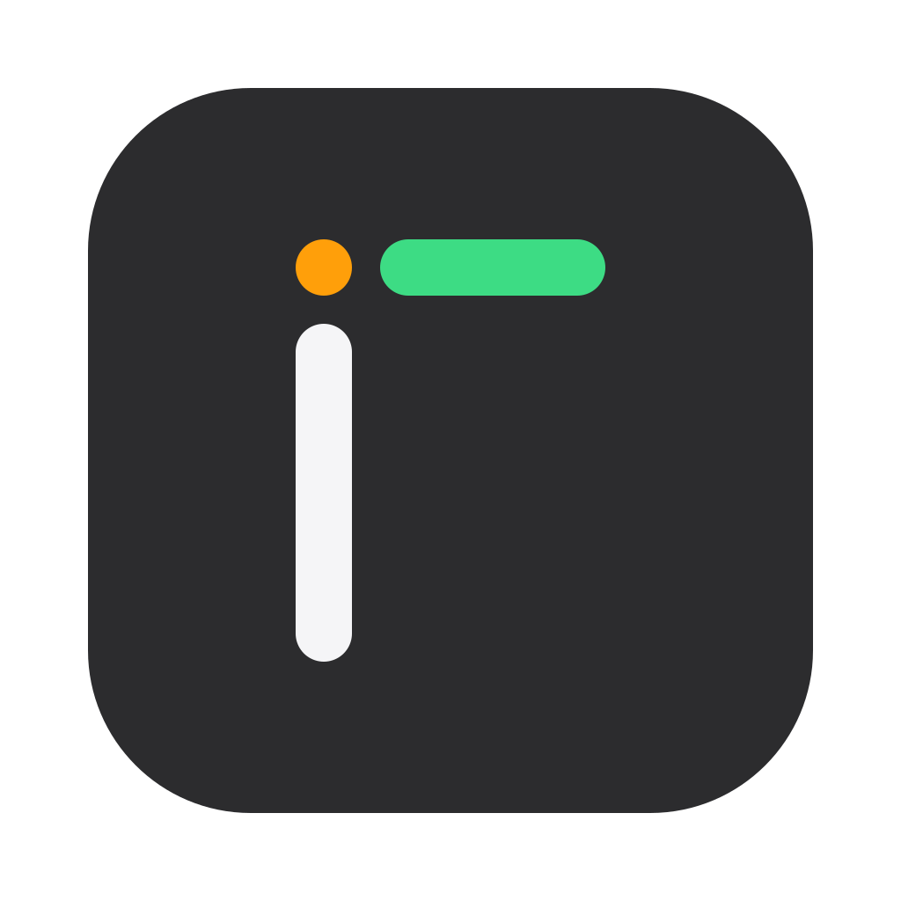
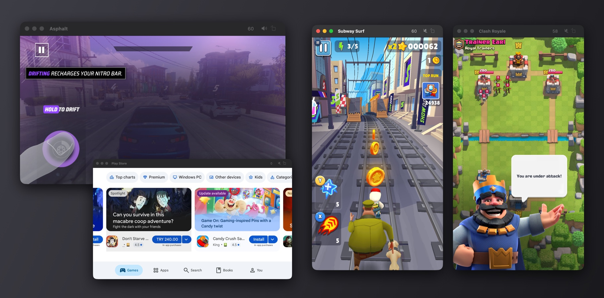

<p align="center">
  
</p>

<h1 align="center">Inquiline</h1>

<p align="center"><b>Android apps on your Mac, as Mac apps.</b></p>

<p align="center">
  <a href="https://github.com/inquiline-app/inquiline/releases/latest"></a>
  
  
  <a href="LICENSE"></a>
</p>

<p align="center"><a href="https://github.com/inquiline-app/inquiline/releases/latest"><b>Download Inquiline</b></a></p>

<p align="center"></p>

Each Android app gets its own window, Dock icon and menu, and shows up in Launchpad, Spotlight and Finder like any other Mac app.

- **Real Android 15**, running on your Mac's own CPU, without translation
- **Fast graphics**: Vulkan 1.3 and OpenGL ES 3.2 on your Mac's GPU through Metal, up to 60 FPS in 3D games
- **Mac-native windows**: resize, full screen, a customizable toolbar with frame rate, mute and rotate
- **Game controllers**, sound, copy and paste, and Android's files in Finder
- **Google Play** if you add it yourself, or any APK
- **Free and open source**, with no accounts and no tracking

Inquiline is free and open source. It's an early preview: expect rough edges, and please report problems: choose **Report a Problem…** from Inquiline in the menu bar, which gathers its logs for you, or [open an issue](https://github.com/inquiline-app/inquiline/issues).

## Not an emulator

Inquiline runs real Android 15 in a small virtual machine, built on the virtualization Apple includes in macOS. Android's apps run on your Mac's own Apple Silicon CPU, without translation, and draw with its GPU through Metal. Each frame reaches the app's window as Android drew it, with no video compression.

## Requirements

- A Mac with Apple Silicon (M1 or later)
- macOS 14 Sonoma or later
- 8 GB of memory; 16 GB or more is better for big games
- About 3 GB of free disk space, plus room for your apps

So far it's been tested on a Mac mini with M4 (macOS 27) and a MacBook Air with M2 and 8 GB (macOS 26). If you try it on another Mac, please [tell us how it went](https://github.com/inquiline-app/inquiline/issues/new/choose), whether it works or not.

## Install

1. Download `Inquiline-<version>-arm64.dmg` from [Releases](https://github.com/inquiline-app/inquiline/releases) and open it.
2. Drag **Inquiline** onto the Applications folder. (If you open it from elsewhere, it offers to move itself there.)
3. Open it. Inquiline isn't notarized by Apple yet (that needs a paid developer account), so macOS stops it the first time:
   - **macOS 15 Sequoia and later:** after the warning, open **System Settings > Privacy & Security**, scroll down, and choose **Open Anyway** next to Inquiline.
   - **macOS 14 Sonoma:** Control-click Inquiline, choose **Open**, then **Open** again.

   You only do this once.

Inquiline lives in the menu bar. The first time, it unpacks Android, which takes under a minute. It checks for new versions once a day, or when you choose **Check for Updates…**.

## Adding apps

- **From an APK:** choose **Add APK…** from Inquiline in the menu bar, or double-click an `.apk` file.
- **From Google Play:** Google's apps can't be included, but you can add them yourself: download [MindTheGapps for Android 15 arm64](https://github.com/MindTheGapps/15.0.0-arm64/releases/latest), choose **Install Google Play…** from the menu bar, then **Choose Zip…**, and pick the zip without opening it (macOS can't open this signed zip, but Inquiline doesn't need it to). If Safari unpacked it, it moved the zip to the Trash: put it back from there, then choose it. More in [docs/google-play.md](docs/google-play.md).

Each app you add appears in your Applications folder and in Launchpad; you can move it into a folder of your own there. To remove one, move it to the Trash; its data stays, so adding it again brings back your saves.

## Using apps

- **Mouse and trackpad** work as touch: click to tap, drag to swipe, scroll to scroll.
- **The toolbar** shows the frame rate and has buttons to mute the app and to turn it between portrait and landscape. **View > Customize Toolbar** changes it.
- **Resize** the window freely; the app keeps its shape. **Ctrl+Cmd+F** goes full screen.
- **Game controllers** connected to the Mac (Xbox, PlayStation, MFi) work in games that support them, as a controller plugged into a phone does. They drive the app in front.
- **Apps keep running** when their window is in the back or minimized, as Mac apps do.
- **Files:** choose **Show Files in Finder** from the menu bar. Android's storage and each app's own folders appear as the **Android** disk.
- Android stops by itself 5 minutes after you quit the last app, unless something is still downloading.

| Mac | Android |
|---|---|
| Click and drag | Touch |
| Scroll | Scroll |
| Typing | Text input |
| Esc | Back |
| Cmd+C, Cmd+X, Cmd+V, Cmd+A | Copy, cut, paste, select all |
| Ctrl+Cmd+F | Full screen |

## Good to know

- **The first launch of a big game is slow.** The game's graphics programs (shaders) are prepared for your Mac's GPU, which can take a few minutes for large 3D games. Later launches are much faster.
- **Not certified by Google.** Apps that check the device's integrity, such as most banking apps and some streaming apps, may refuse to run. Google may also limit Google Play on uncertified devices.
- **Not for sensitive apps.** This preview's Android is a development build with root access, so don't use it for banking, payments or other sensitive accounts.
- **Missing hardware:** no camera, microphone, location or vibration yet, and the trackpad doesn't do multi-touch gestures.
- **Memory:** Android can use up to 8 GB on Macs with 16 GB or more, 4 GB on others, and gives back what it frees.
- **Privacy:** everything stays on your Mac. Inquiline itself only asks GitHub once a day whether there's a new version; apps reach the internet as on a phone.
- **Logs:** Inquiline, its engine and Android keep logs on your Mac, about 50 MB at most, for finding what went wrong. They stay there: only **Report a Problem…** gathers them, into a zip you can look at and send yourself, with your name, e-mail addresses, web addresses and numbers that could identify you taken out.

App data lives in `~/Library/Application Support/Inquiline`. Deleting that folder resets Android, and deletes every app and its data.

## How it works

- A Linux virtual machine, run by QEMU on Apple's Hypervisor framework, runs Android 15 ([Redroid](https://github.com/remote-android/redroid-doc)).
- Android's Vulkan reaches the Mac's GPU through [gfxstream](https://android.googlesource.com/platform/hardware/google/gfxstream) and [MoltenVK](https://github.com/KhronosGroup/MoltenVK); its OpenGL ES is ANGLE on that Vulkan. Android has Vulkan 1.3 and OpenGL ES 3.2.
- Each app runs on its own Android display. Its frames are copied once on the GPU into memory its window shares with the VM.
- Sound goes through a virtual sound card to CoreAudio, controllers through virtual USB devices, and files to Finder through a local network disk.

More detail is in [Research/linux-gpu](Research/linux-gpu/README.md).

## Building

Building needs Xcode, Homebrew and the VM's parts; see [Research/linux-gpu](Research/linux-gpu/README.md).

```bash
Scripts/build-app.sh --dmg
```

This writes `build/Inquiline.app` and the release disk image. `Scripts/make-appcast.sh` then adds it to `appcast.xml`, which [Sparkle](https://sparkle-project.org) reads to offer updates; it signs it with the update key in the Keychain. To try a first launch without touching your data, start the app with `INQUILINE_HOME` set to an empty folder with a short path, such as `/tmp/inquiline` (the windows' frames go through a socket in it, and macOS limits socket paths to 104 characters). That copy keeps its apps in the folder too.

## License

Inquiline is licensed under the [Apache License 2.0](LICENSE). It includes open source software under other licenses, among them the GPL; see [THIRD-PARTY-NOTICES.md](THIRD-PARTY-NOTICES.md) for the full list and where to get the source code.

Android is a trademark of Google LLC. Mac, macOS and Apple Silicon are trademarks of Apple Inc. Inquiline isn't affiliated with or endorsed by Google or Apple.
