<p align="center">
  
</p>

<h1 align="center">Inquiline</h1>

<p align="center"><b>Android apps on your Mac, as Mac apps.</b></p>

<p align="center">
  <a href="https://github.com/inquiline-app/inquiline/releases/latest"></a>
  
  
  <a href="LICENSE"></a>
</p>

<p align="center"><a href="https://github.com/inquiline-app/inquiline/releases/latest"><b>Download Inquiline</b></a> · <a href="#install">How to install</a> · <a href="#good-to-know">Good to know</a></p>

<p align="center">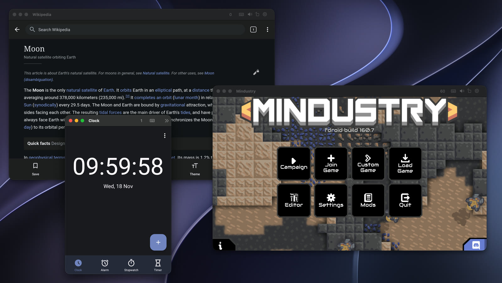</p>

Android apps on your Mac don't have to live inside a phone-shaped box. With Inquiline, each one gets a window of its own, an icon in the Dock and Launchpad, a place in Spotlight and Finder, and notifications in Notification Center. Behind them runs real Android 15, on your Mac's own chip. Free, open source, no account.

## Double-click an APK. That's it.

<p align="center">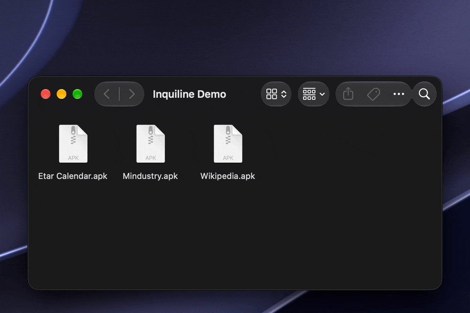</p>

Open an `.apk`, or a bundle such as `.xapk`, `.apkm` or `.apks`, and a few seconds later the app is in your Applications folder, ready like any Mac app. Add Google Play, and apps come straight from the Play Store.

## Your phone is the remote

<p align="center">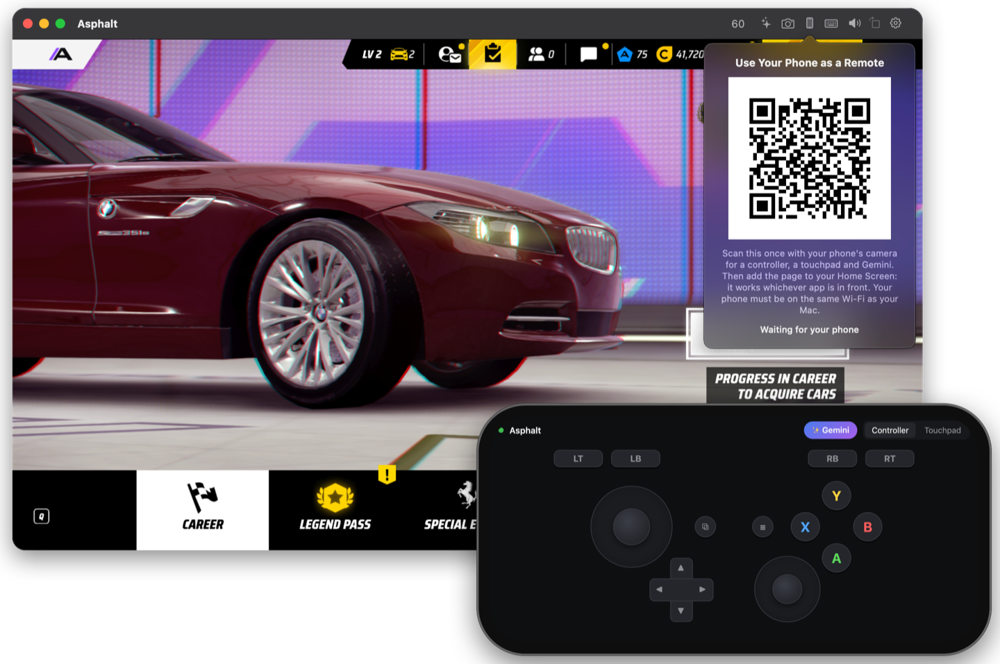</p>

Scan the QR code under the phone button and your phone becomes a remote, as Apple's TV Remote is for an Apple TV. Touch the app as if it were on the phone, type with the phone's keyboard, use it as a trackpad, take a screenshot, or open any of your apps from the list. A second phone joins as player two.

**Then take the window with you.** One key moves the app's window onto your phone, full screen and with its sound, and you keep playing there by touch. Swipe up with three fingers and it's back on your Mac. Nothing to install: the remote is a web page from your Mac.

## Games, with keys and a mouse

Games run on your Mac's GPU, with Vulkan 1.3 and OpenGL ES 3.2, at up to 60 frames a second, and macOS gives them Game Mode. Touch-only games become keyboard games: put keys on buttons, a W A S D stick on the joystick, and aim with the mouse in shooters. Record a combo once by playing it, and replay it with one key. Xbox, PlayStation and MFi controllers work too.

## Gemini, over any app

<p align="center">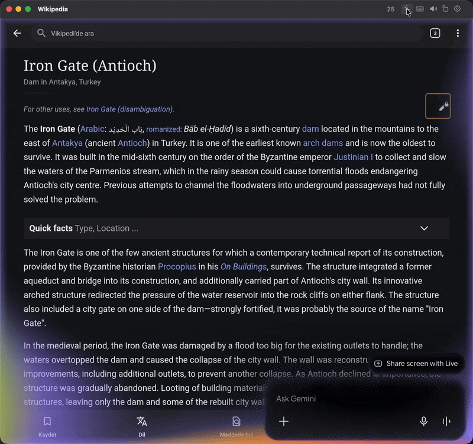</p>

Press ✨ and ask about whatever the app shows: the article, the chat, the level you're stuck on. With **Share screen with Live** you just talk, and Gemini follows along as you use the app. Gemini needs Google Play and the Google and Gemini apps from it.

## No ads, app by app

<p align="center">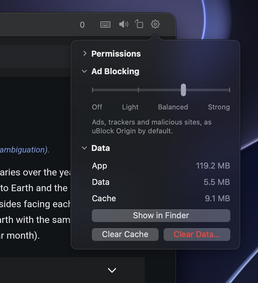</p>

Pick an app, move the slider, and its ads are gone: banners, videos between levels, and the ads that apps fetch through Google Play services. Apps you leave alone stay exactly as they are. It uses the lists of uBlock Origin and AdGuard, updated every day, and it counts what it blocked.

## All your Android apps in the Dock

<p align="center">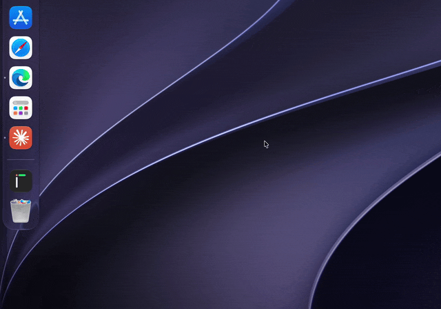</p>

Your Android apps live together in Applications › Inquiline Apps, and Spotlight and Launchpad list them with the rest. Choose **Show Android Apps in Dock** from Inquiline in the menu bar to keep them all one click away, in a grid.

## Windows that fit

<p align="center">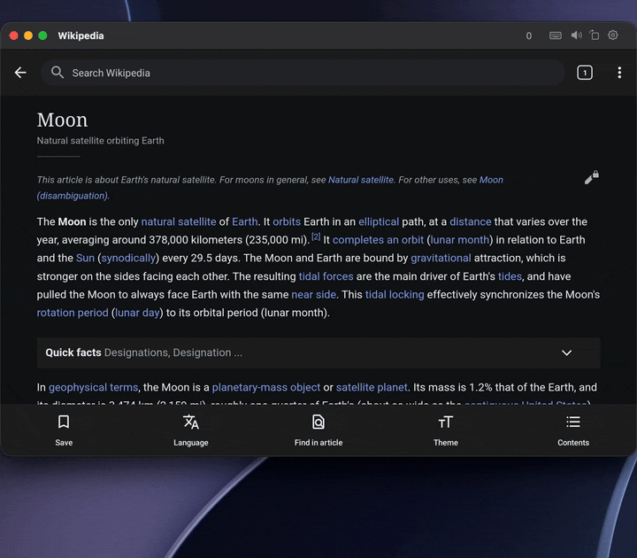</p>

Widen a window and the app redraws itself for the new size, with its tablet layout if it has one, instead of stretching a phone screen. Games keep their shape and scale up to full screen.

## Notifications in Notification Center

<p align="center">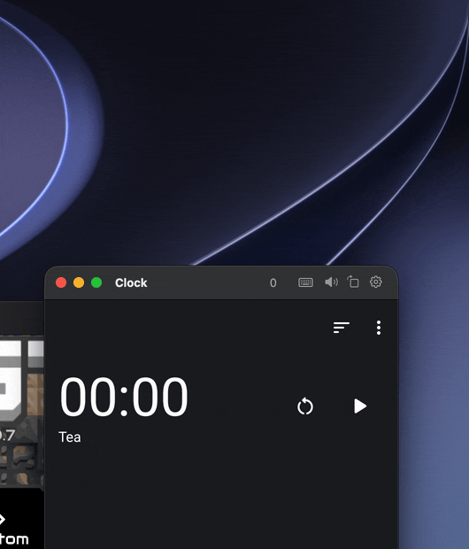</p>

Apps reach you while you work in something else, even with no window open. Click a notification to land right on the chat that got the message, or reply without opening anything.

## Android's files are just a folder

<p align="center">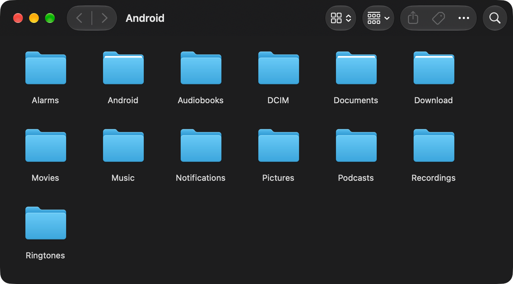</p>

Photos, downloads and documents are real files in the **Android** folder in your home folder. Drop a photo in and Android's apps see it in seconds; what an app saves shows up in Finder at once. Nothing to mount, nothing to sync.

## Widgets on your desktop

<p align="center">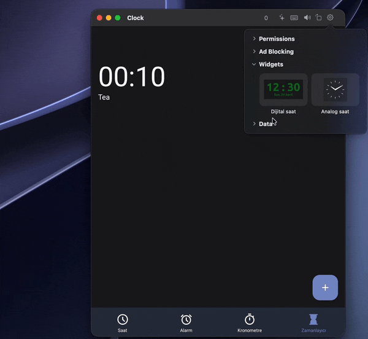</p>

An app's widgets go on your desktop, live, as Android draws them. Tap them, scroll them, and drag them anywhere.

## And more

- **Performance at a glance:** click the frame rate in the toolbar for frames per second over the last half minute, and the CPU, GPU and memory in use.
- **Sound per app:** Android's volume, Mute This App, an equalizer and loudness, under the speaker button. Sound stays in step with the picture, and follows your Mac to headphones or a display.
- **Screenshots and recordings** of the app's screen alone, at full resolution and with sound, saved where your Mac saves its own.
- **Each app's settings** in the gear: permissions, widgets, data, ad blocking and performance.

<p align="center">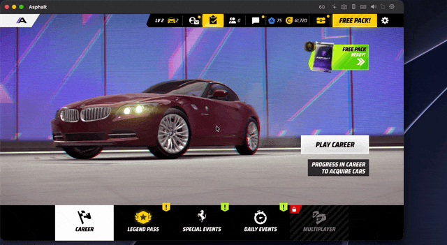</p>

<p align="center">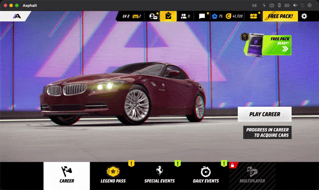 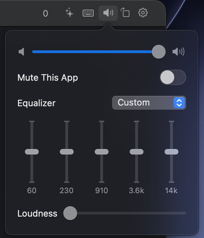</p>

## Your data stays on your Mac

Nothing about what you do in Android leaves your Mac through Inquiline. Inquiline itself only asks GitHub once a day whether there's a new version, and the ad blocker fetches its lists from their publishers. Other apps can't connect to Android, and Inquiline's folder is closed to other user accounts.

## Not an emulator

<p align="center">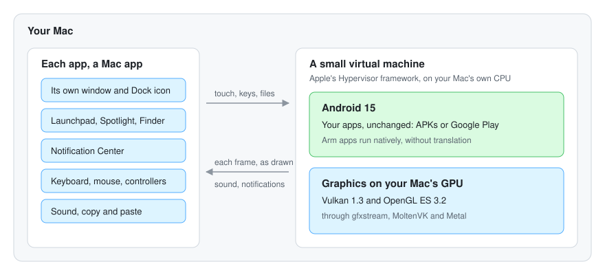</p>

Android runs in a small virtual machine, built on the virtualization Apple includes in macOS. Android's Arm apps run on your Mac's Apple Silicon as they are, without translation, and draw with its GPU through Metal. Each frame reaches the app's window as Android drew it, without video compression.

## Requirements

- A Mac with Apple Silicon (M1 or later)
- macOS 14 Sonoma or later
- 8 GB of memory; 16 GB or more is better for big games
- About 3 GB of free disk space, plus room for your apps

So far it's been tested on a Mac mini with M4 (macOS 27) and a MacBook Air with M2 and 8 GB (macOS 26). If you try it on another Mac, please [tell us how it went](https://github.com/inquiline-app/inquiline/issues/new/choose), whether it works or not.

## Install

With [Homebrew](https://brew.sh):

```bash
brew install --cask inquiline-app/tap/inquiline
```

Then open Inquiline and allow it once, as in step 3 below. Or install it by hand:

1. Download `Inquiline-<version>-arm64.dmg` from [Releases](https://github.com/inquiline-app/inquiline/releases) and open it.
2. Drag **Inquiline** onto the Applications folder. (If you open it from elsewhere, it offers to move itself there.)
3. Open it. Inquiline isn't notarized by Apple yet (that needs a paid developer account), so macOS stops it the first time:
   - **macOS 15 Sequoia and later:** after the warning, open **System Settings > Privacy & Security**, scroll down, and choose **Open Anyway** next to Inquiline.
   - **macOS 14 Sonoma:** Control-click Inquiline, choose **Open**, then **Open** again.

   You only do this once.

Inquiline lives in the menu bar. The first time, it unpacks Android, which takes under a minute. It checks for new versions once a day, or when you choose **Check for Updates…**.

## Adding apps

- **From an APK:** double-click an `.apk` file, or choose **Add APK…** from Inquiline in the menu bar.
- **From Google Play:** Google's apps can't be included, but you can add them yourself: download [MindTheGapps for Android 15 arm64](https://github.com/MindTheGapps/15.0.0-arm64/releases/latest), choose **Install Google Play…** from the menu bar, then **Choose Zip…**, and pick the zip without opening it. If Safari unpacked it, it moved the zip to the Trash: put it back from there, then choose it. More in [docs/google-play.md](docs/google-play.md).

Each app you add appears in your Applications folder and in Launchpad; you can move it into a folder of your own there. To remove one, move it to the Trash: it's removed from Android with its data, as deleting an app on a phone is.

## Using apps

| Mac | Android |
|---|---|
| Click and drag | Touch |
| Scroll, pinch, rotate | Scroll, pinch, rotate |
| Typing | Text input |
| Esc | Back |
| Cmd+C, Cmd+X, Cmd+V, Cmd+A | Copy, cut, paste, select all |
| Cmd+K | Keyboard controls for games |
| Ctrl+Cmd+F | Full screen |

- **The toolbar** shows the frame rate and has buttons for Gemini, screenshots and recordings, the phone remote, keyboard controls, sound, turning between portrait and landscape, and the app's settings. **View > Customize Toolbar** changes it.
- **Windows** open where and as large as you left them, and an app closed in full screen opens in full screen.
- **Closing a window quits the app**, as swiping it away on a phone does. Apps keep running while their window is in the back or minimized.
- **Files:** Android's storage is the **Android** folder in your home folder. **Show Files in Finder** in the menu bar opens it, and **Show in Finder** in an app's settings opens that app's own files.
- **Android rests** when no app needs it, as a phone does, and wakes for notifications and alarms. When your Mac needs memory, Android closes apps in the background.
- **Android follows your Mac:** its language, dark mode, time zone and 24-hour clock are your Mac's, and its storage is your Mac's free space. Apps that listen or ask where you are use your Mac's microphone and location, after macOS asks you once.

## Good to know

- **The first launch of a big game is slow.** The game's graphics programs (shaders) are prepared for your Mac's GPU, which can take a few minutes for large 3D games. Later launches are much faster.
- **Not certified by Google.** Apps that check the device's integrity, such as most banking apps and some streaming apps, may refuse to run. Google may also limit Google Play on uncertified devices; **Register with Google…** in the menu bar helps with that.
- **Not for sensitive apps.** This preview's Android is a development build with root access, so don't use it for banking, payments or other sensitive accounts.
- **Missing hardware:** no camera or vibration yet.
- **Memory:** Android can use up to 12 GB on Macs with 16 GB or more, 4 GB on others, and gives back what it frees.
- **Logs:** Inquiline, its engine and Android keep logs on your Mac, about 50 MB at most, for finding what went wrong. They stay there: only **Report a Problem…** gathers them, into a zip you can look at and send yourself, with your name, e-mail addresses, web addresses and numbers that could identify you taken out.

Inquiline is an early preview: expect rough edges, and please report problems with **Report a Problem…** in the menu bar, or [open an issue](https://github.com/inquiline-app/inquiline/issues).

App data lives in `~/Library/Application Support/Inquiline`. Deleting that folder resets Android, and deletes every app and its data.

**To uninstall,** move Inquiline to the Trash while it's running in the menu bar: it removes the apps you added, Android with everything in it, and its own settings, caches and logs, leaving nothing behind.

## How it works

- A Linux virtual machine, run by QEMU on Apple's Hypervisor framework, runs Android 15 ([Redroid](https://github.com/remote-android/redroid-doc)).
- Android's Vulkan reaches the Mac's GPU through [gfxstream](https://android.googlesource.com/platform/hardware/google/gfxstream) and [MoltenVK](https://github.com/KhronosGroup/MoltenVK); its OpenGL ES is ANGLE on that Vulkan.
- Each app runs on its own Android display. Its frames are copied once on the GPU into memory its window shares with the VM.
- Sound goes through a virtual sound card to CoreAudio, controllers through virtual USB devices, and Android's shared storage is a folder on the Mac.
- Ad blocking is a small VPN and filtering proxy inside Android, for the apps you choose, using Brave's engine with uBlock Origin's lists and rules.

More detail is in [Research/linux-gpu](Research/linux-gpu/README.md).

## Building

Building needs Xcode, Homebrew and the VM's parts; see [Research/linux-gpu](Research/linux-gpu/README.md).

```bash
Scripts/build-app.sh --dmg
```

This writes `build/Inquiline.app` and the release disk image. `Scripts/make-appcast.sh` then adds it to `appcast.xml`, which [Sparkle](https://sparkle-project.org) reads to offer updates; it signs it with the update key in the Keychain. To try a first launch without touching your data, start the app with `INQUILINE_HOME` set to an empty folder with a short path, such as `/tmp/inquiline` (the VM's sockets are in it, and macOS limits socket paths to 104 characters). That copy keeps its apps in the folder too.

## License

Inquiline is licensed under the [Apache License 2.0](LICENSE). It includes open source software under other licenses, among them the GPL; see [THIRD-PARTY-NOTICES.md](THIRD-PARTY-NOTICES.md) for the full list and where to get the source code.

The apps shown above are [Wikipedia](https://github.com/wikimedia/apps-android-wikipedia), [Mindustry](https://github.com/Anuken/Mindustry) and [Fossify Clock](https://github.com/FossifyOrg/Clock), all open source, installed from [F-Droid](https://f-droid.org). Other apps and games shown are their owners' trademarks.

Android is a trademark of Google LLC. Mac, macOS and Apple Silicon are trademarks of Apple Inc. Inquiline isn't affiliated with or endorsed by Google or Apple.
